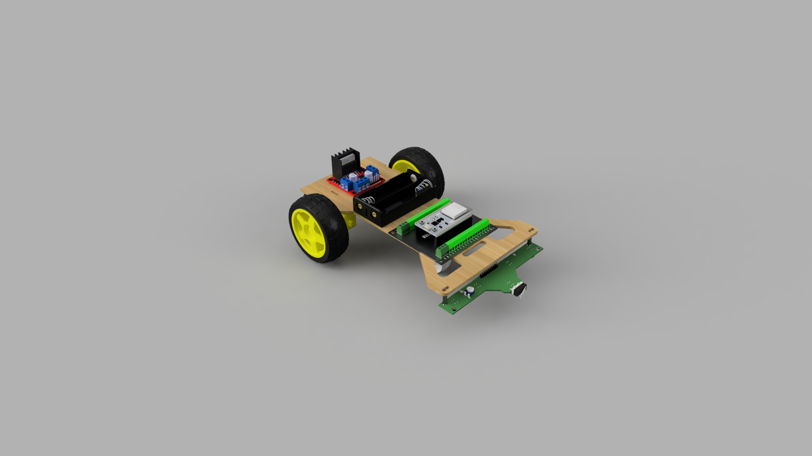

# TEI201: Taller de Diseño en Ingeniería Sec. 1
# Automatización de Bodegas PYME mediante Robot Sigue Líneas

## Integrantes
* Vicente Correa
* Fernando Toledo
* Maximiliano Basauri

### Universidad Adolfo Ibañez

## Descripcción del Proyecto
Este proyecto consiste en el diseño y desarrollo de un Vehículo de Guiado Automático (AGV) en formato de robot sigue líneas, diseñado específicamente para optimizar la intralogística en pequeñas y medianas empresas (PYMEs) del sector e-commerce en Chile. A diferencia de prototipos genéricos, este modelo cuenta con un chasis personalizado fabricado en madera mediante corte láser, una configuración de tracción delantera (dos motores frontales y una rueda de apoyo trasera) y un **array de sensores infrarrojos** para garantizar un seguimiento de trayectoria preciso mediante control de lazo cerrado.

## Problemática (Conexión ODS 9)
Actualmente en las bodegas PYME en Chile (menores de 500m^2 y con pasillos angostos) carecen de automatización. EL proceso de picking y traslado de carga se realiza manualmente. Los operarios caminan entre 10 y 15 km diarios, destinando hasta un 55% de su jornada laboral únicamente a desplazarse. Esto genera fatiga física, demoras significativas e ineficiencia logística. Nuestro proyecto busca eliminar este tiempo de traslado improductivo mediante tecnología accesible, modular y escalable.

## Componentes Utilizados (Hardware Principal)
* **Estructura:** Chasis de madera (MDF) diseñado en Fusion 360 y manufacturado mediante corte laser
* **Tracción:** 2x Motores DC con reductores (ruedas delanteras) + 1 rueda omnidireccional (apoyo trasero)
* **Controlador:** ESP32
* **Sensores:** Array de sensores infrarrojos para lectura de línea de alta resolución.

## Arquitectura del Sistema y Control

El prototipo opera como un Vehículo de Guiado Automático (AGV) de tracción diferencial controlado por un **ESP32** con ejecución dual-core:
* **Núcleo 1 (Control en tiempo real a 100 Hz):** Lectura del *array* infrarrojo de 5 canales (**BFD-1000**), cálculo del error lateral ponderado $e(t) \in [-2{,}0;\, +2{,}0]$ y ejecución de un controlador **PD** ($K_p = 40{,}0$, $K_d = 22{,}0$, `BASE_SPEED = 170` PWM) sobre puente H **L298N**.
* **Núcleo 0 (Telemetría IoT y Dashboard Web):** Punto de acceso WiFi local (`Robot-TEI201` en `http://192.168.4.1`) que permite iniciar/detener corridas de forma remota, visualizar en vivo los 5 sensores, graficar error/PWM a $50\text{ Hz}$ y exportar registros en formato `.csv`.

## Resumen de Validación Experimental

Se ejecutaron **9 corridas experimentales** ($7.136$ muestras telemétricas) evaluando tres niveles de carga útil calibrada ($0\text{ g}$, $100\text{ g}$ y $200\text{ g}$):

| Condición de carga | Tasa de éxito | Tiempo en línea | Tiempo centrado ($\|e\| \le 0{,}5$) | MAE | Periodo lazo |
| :--- | :---: | :---: | :---: | :---: | :---: |
| **Sin carga ($0\text{ g}$)** | **100 %** (3/3) | 97,3 % | 73,9 % | 0,568 | 10,00 ms |
| **Carga media ($100\text{ g}$)** | **100 %** (3/3) | 94,4 % | 57,0 % | 0,760 | 10,00 ms |
| **Carga alta ($200\text{ g}$)** | **0 %** (0/3) | 79,5 % | 39,2 % | 0,969 | 10,00 ms |

* **Régimen nominal validado ($0\text{ g}$ – $100\text{ g}$):** $100\text{ \%}$ de recorridos completados sin pérdida de trayectoria y latencia constante de $10{,}00\text{ ms}$.
* **Límite dinámico ($200\text{ g}$):** Identificado en curva final por inercia lateral superior al par diferencial (`LOST_TIMEOUT_MS = 1500 ms`).

El protocolo completo, las ecuaciones, los registros CSV y el análisis estadístico están documentados en [`testing/README.md`](testing/README.md).

## Estructura del Repositorio

* [`diseño-3d/`](diseño-3d/) — Modelo paramétrico Fusion 360 (`.f3z`), planos técnicos (`Plano.pdf`), archivos de corte láser (`.dxf`, `.svg`) y renders.
* [`hardware/`](hardware/) — Lista de materiales y costos ([`BOM.xlsx`](hardware/BOM.xlsx)) y esquema eléctrico ([`Diagrama de circuito.pdf`](hardware/Diagrama%20de%20circuito.pdf)).
* [`firmware/`](firmware/sketch_nov22b_wifi_bt/sketch_nov22b_wifi_bt.ino) — Código fuente en C++/Arduino para ESP32 con control PD y servidor web de telemetría.
* [`testing/`](testing/README.md) — Protocolo experimental (a–h), 9 archivos `.csv`, planilla [`desempeno_testing_robot.xlsx`](testing/desempeno_testing_robot.xlsx), script Python y evidencia fotográfica.
* [`docs/`](docs/) — Presentación del Avance #3 y documentación de respaldo.