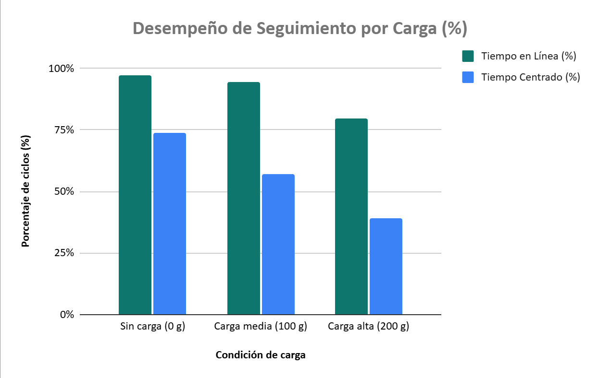
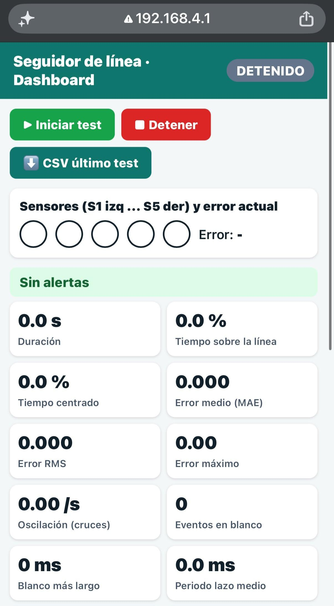
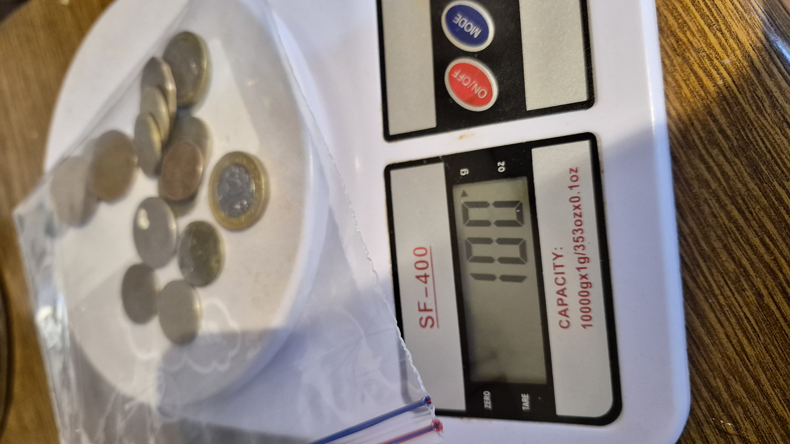
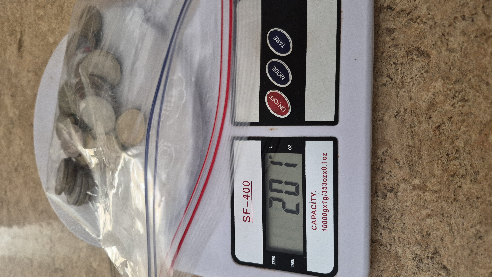

# Protocolo y Resultados de Validación Experimental (Testing)

## a) Objetivo de las pruebas
Evaluar la **precisión de seguimiento de trayectoria**, la **estabilidad del control en lazo cerrado (PD)** y la **capacidad de carga útil** del prototipo de Vehículo de Guiado Automático (AGV) bajo tres condiciones de masa transportada ($0\text{ g}$, $100\text{ g}$ y $200\text{ g}$).

Esta validación responde directamente a la problemática identificada en el Avance 1: automatizar el traslado interno de carga liviana en bodegas PYME con pasillos angostos, garantizando que el vehículo mantenga su trayectoria sin salirse de la guía ni comprometer la seguridad operativa al incrementar el peso transportado.

---

## b) Variables y parámetros de medición

### Variables independientes (controladas)
* **Masa de carga útil ($m$):** Tres niveles experimentales fijados sobre el chasis: $0\text{ g}$ (línea base), $100\text{ g}$ (carga media) y $200\text{ g}$ (carga alta).
* **Parámetros del controlador PD:** Ganancia proporcional $K_p = 40{,}0$, ganancia derivativa $K_d = 22{,}0$, velocidad crucero `BASE_SPEED = 170` PWM, velocidad máxima `MAX_SPEED = 200` PWM y freno diferencial máximo `MAX_REV = -120` PWM.
* **Geometría de pista y entorno:** Circuito cerrado de cinta negra mate sobre superficie clara en ambiente interior con iluminación artificial controlada.

### Variables dependientes (medidas por telemetría a 50 Hz)
* **Estado del array infrarrojo (`sensores`):** Vector binario de 5 canales (`S1` a `S5`) con pesos espaciales $[-2{,}0;\, -1{,}0;\, 0{,}0;\, +1{,}0;\, +2{,}0]$.
* **Error lateral instantáneo ($e$):** Desviación respecto al centro de la línea calculada como centro de masa ponderado ($e \in [-2{,}0;\, +2{,}0]$).
* **Esfuerzo de control y velocidades aplicadas (`vel_izq`, `vel_der`):** Señal PWM efectiva enviada a cada rueda motriz.
* **Latencia del lazo de control (`periodo_us`):** Tiempo de ejecución entre iteraciones consecutivas del microcontrolador.
* **Duración de corrida ($t$) y eventos de pérdida de línea:** Tiempo total de recorrido y duración de intervalos sin detección (`sensores = 00000`).

### Indicadores clave de desempeño (KPIs)
1. **Tasa de éxito de recorrido (%):** Porcentaje de corridas completadas sin superar el umbral de pérdida de línea (`1500 ms`).
2. **Tiempo sobre la línea (%):** Porcentaje de ciclos totales en los que al menos un sensor detecta la guía negra.
3. **Tiempo centrado (%):** Porcentaje de ciclos en línea donde $|e| \le 0{,}5$.
4. **Error Medio Absoluto (MAE) y Error Cuadrático Medio (RMS):** Magnitud promedio y dispersión cuadrática de la desviación lateral.
5. **Tasa de oscilación (cruces/s):** Frecuencia de cambios de signo del error fuera de la banda muerta ($\pm 0{,}25$), indicador de zigzag.

---

## c) Condiciones experimentales
* **Hardware evaluado:** Chasis de MDF cortado por láser con tracción diferencial delantera (2 motores DC con caja reductora + rueda loca trasera), controlador **ESP32**, puente H **L298N**, *array* de 5 sensores infrarrojos (**BFD-1000**) y alimentación mediante baterías Li-Ion de $3{,}7\text{ V}$ en serie.
* **Instrumentación y registro:** Módulo de telemetría embebido en el ESP32 (`../firmware/sketch_nov22b_wifi_bt/sketch_nov22b_wifi_bt.ino`), operando en modo punto de acceso WiFi (`192.168.4.1`) con servidor web en el núcleo 0 y lazo de control en tiempo real en el núcleo 1. Los datos se registran cada 2 ciclos de control ($50\text{ Hz}$, resolución temporal de $20\text{ ms}$) y se exportan en formato `.csv`.
* **Rango de operación y seguridad:** Lazo de control operando a $100\text{ Hz}$ ($10\text{ ms}$ nominales), corte automático por pérdida de línea tras `LOST_TIMEOUT_MS = 1500 ms` y tiempo máximo de seguridad de `120 s`.

---

## d) Procedimiento experimental
1. **Preparación y verificación inicial:** Encender el AGV sobre la superficie clara de la pista, conectar el equipo de monitoreo a la red `Robot-TEI201` (`http://192.168.4.1`) y comprobar en el panel en vivo que los 5 sensores respondan exclusivamente al paso de la guía negra.
2. **Bloque 1 — Línea base sin carga ($0\text{ g}$):**
   * Posicionar el robot alineado en la marca de inicio con el sensor central `S3` sobre la línea.
   * Activar el inicio desde el dashboard (`g`), dejando transcurrir la cuenta regresiva de $3\text{ s}$.
   * Registrar el recorrido completo hasta la meta, detener la captura (`s`) y descargar el archivo `.csv` correspondiente.
   * Repetir el procedimiento hasta completar **3 corridas válidas** (`test_robot.csv`, `test_robot (1).csv`, `test_robot (2).csv`).
3. **Bloque 2 — Carga media ($100\text{ g}$):**
   * Fijar una masa calibrada de $100\text{ g}$ sobre la plataforma superior del chasis, centrada sobre el eje delantero para mantener la tracción.
   * Ejecutar **3 corridas** bajo el mismo protocolo de partida y descargar cada registro `.csv` (`test_robot (3).csv`, `test_robot (4).csv`, `test_robot (5).csv`).
4. **Bloque 3 — Carga alta ($200\text{ g}$):**
   * Incrementar la carga fijada a $200\text{ g}$ en la misma posición.
   * Ejecutar **3 corridas**, registrando tanto el seguimiento durante el trayecto como el instante de corte automático en caso de desviación por inercia, y descargar cada archivo `.csv` (`test_robot (6).csv`, `test_robot (7).csv`, `test_robot (8).csv`).

---

## e) Criterios de aceptación y validación
Para considerar que el prototipo cumple satisfactoriamente con su función operativa en esta etapa de validación, se establecen los siguientes umbrales cuantitativos:
* **Estabilidad de tiempo real:** Periodo medio del lazo de control menor o igual a $15\text{ ms}$ y latencia máxima inferior a $25\text{ ms}$ en el $100\text{ \%}$ de las corridas.
* **Confiabilidad de navegación:** Tasa de éxito del $100\text{ \%}$ sin pérdida de trayectoria para condición sin carga ($0\text{ g}$) y carga nominal de prueba ($100\text{ g}$).
* **Permanencia y precisión en pista:** Tiempo sobre la línea mayor o igual al $90\text{ \%}$, tiempo centrado mayor o igual al $55\text{ \%}$ y error medio absoluto ($\text{MAE}$) menor a $0{,}85$ en condiciones nominales.
* **Identificación de límite de carga:** Determinación experimental de la masa crítica a partir de la cual la inercia lateral excede la capacidad de corrección diferencial del controlador PD actual.

---

## f) Tratamiento y análisis de datos

### 1. Formulación matemática del control y métricas
El firmware del ESP32 calcula el error lateral instantáneo $e(t)$ mediante el centro de masa ponderado de los sensores activos sobre la línea negra:

$$e(t) = \frac{\sum_{i=1}^{5} w_i \cdot s_i(t)}{\sum_{i=1}^{5} s_i(t)}, \quad \text{con } w = [-2{,}0;\, -1{,}0;\, 0{,}0;\, +1{,}0;\, +2{,}0]$$

donde $s_i(t) \in \{0, 1\}$ representa el estado binario del canal $S_i$. A partir de este error, la acción correctiva diferencial $u(t)$ aplicada a los motores izquierdo y derecho sigue la ley proporcional-derivativa (PD):

$$u(t) = K_p \cdot e(t) + K_d \cdot \big(e(t) - e(t-1)\big)$$

$$\text{PWM}_{\text{izq}} = \text{clip}(\text{BASE\_SPEED} + u(t),\, \text{MAX\_REV},\, \text{MAX\_SPEED})$$

$$\text{PWM}_{\text{der}} = \text{clip}(\text{BASE\_SPEED} - u(t),\, \text{MAX\_REV},\, \text{MAX\_SPEED})$$

Para cuantificar la precisión global de cada corrida sobre los $N$ ciclos válidos en línea, se emplean el Error Medio Absoluto ($\text{MAE}$) y el Error Cuadrático Medio ($\text{RMS}$):

$$\text{MAE} = \frac{1}{N}\sum_{k=1}^{N} |e_k|, \qquad \text{RMS} = \sqrt{\frac{1}{N}\sum_{k=1}^{N} e_k^2}$$

### 2. Resultados individuales por corrida (9 ensayos)

| Archivo CSV | ID Test | Condición de carga | Duración (s) | En línea (%) | Centrado (%) | MAE | RMS | Cruces/s | Eventos blanco | Blanco máx (ms) | PWM medio | Estado final |
| :--- | :---: | :--- | :---: | :---: | :---: | :---: | :---: | :---: | :---: | :---: | :---: | :--- |
| `test_robot.csv` | #2 | Sin carga ($0\text{ g}$) | 15,59 | 97,3 % | 70,8 % | 0,593 | 0,692 | 1,86 | 3 | 320 | 168,0 | Completada |
| `test_robot (1).csv` | #1 | Sin carga ($0\text{ g}$) | 16,67 | 97,7 % | 74,6 % | 0,555 | 0,657 | 1,68 | 3 | 260 | 168,3 | Completada |
| `test_robot (2).csv` | #3 | Sin carga ($0\text{ g}$) | 15,53 | 96,8 % | 76,5 % | 0,557 | 0,660 | 1,74 | 2 | 440 | 168,3 | Completada |
| `test_robot (3).csv` | #4 | Carga media ($100\text{ g}$) | 17,01 | 95,2 % | 55,9 % | 0,773 | 0,927 | 1,47 | 8 | 380 | 165,5 | Completada |
| `test_robot (4).csv` | #5 | Carga media ($100\text{ g}$) | 17,93 | 98,1 % | 61,7 % | 0,690 | 0,825 | 1,39 | 6 | 100 | 166,5 | Completada |
| `test_robot (5).csv` | #6 | Carga media ($100\text{ g}$) | 15,65 | 89,9 % | 53,4 % | 0,817 | 0,963 | 1,41 | 9 | 420 | 164,9 | Completada |
| `test_robot (6).csv` | #9 | Carga alta ($200\text{ g}$) | 15,27 | 76,2 % | 40,9 % | 1,055 | 1,284 | 0,79 | 14 | 1480 | 157,0 | Desviación al cierre |
| `test_robot (7).csv` | #10 | Carga alta ($200\text{ g}$) | 14,31 | 80,6 % | 36,4 % | 0,920 | 1,039 | 0,98 | 8 | 1480 | 162,2 | Desviación al cierre |
| `test_robot (8).csv` | #11 | Carga alta ($200\text{ g}$) | 14,67 | 81,7 % | 40,3 % | 0,933 | 1,080 | 0,95 | 8 | 1500 | 161,4 | Desviación al cierre |

### 3. Resumen estadístico consolidado (Media $\pm$ Desviación Estándar)

| Condición de carga | Éxito (%) | Duración (s) | Tiempo en línea (%) | Tiempo centrado (%) | MAE | RMS | Oscilación (cruces/s) | Blanco acumulado (ms) | Periodo lazo medio / máx (ms) |
| :--- | :---: | :---: | :---: | :---: | :---: | :---: | :---: | :---: | :---: |
| **Sin carga ($0\text{ g}$)** | **100 %** (3/3) | $15{,}93 \pm 0{,}64$ | $97{,}3 \pm 0{,}5\text{ \%}$ | $73{,}9 \pm 2{,}9\text{ \%}$ | $0{,}568 \pm 0{,}021$ | $0{,}670 \pm 0{,}019$ | $1{,}76 \pm 0{,}09$ | $433\text{ ms}$ | $10{,}00$ / $10{,}01$ |
| **Carga media ($100\text{ g}$)** | **100 %** (3/3) | $16{,}86 \pm 1{,}15$ | $94{,}4 \pm 4{,}2\text{ \%}$ | $57{,}0 \pm 4{,}3\text{ \%}$ | $0{,}760 \pm 0{,}065$ | $0{,}905 \pm 0{,}071$ | $1{,}42 \pm 0{,}04$ | $913\text{ ms}$ | $10{,}00$ / $10{,}01$ |
| **Carga alta ($200\text{ g}$)** | **0 %** (0/3) | $14{,}75 \pm 0{,}48$ | $79{,}5 \pm 2{,}9\text{ \%}$ | $39{,}2 \pm 2{,}5\text{ \%}$ | $0{,}969 \pm 0{,}074$ | $1{,}134 \pm 0{,}132$ | $0{,}91 \pm 0{,}10$ | $3013\text{ ms}$ | $10{,}00$ / $10{,}01$ |

### 4. Distribución espacial de activación de sensores (`S1` a `S5`)

| Condición de carga | `S1` (Ext. Izq) | `S2` (Izq) | `S3` (Centro) | `S4` (Der) | `S5` (Ext. Der) | Interpretación física |
| :--- | :---: | :---: | :---: | :---: | :---: | :--- |
| **Sin carga ($0\text{ g}$)** | 0,0 % | 31,5 % | 71,9 % | 53,0 % | 1,3 % | Trayectoria confinada al núcleo central (`S2-S3-S4`). |
| **Carga media ($100\text{ g}$)** | 0,5 % | 35,5 % | 53,9 % | 43,5 % | 8,3 % | Mayor excursión lateral en curvas hacia `S5`, sin pérdida. |
| **Carga alta ($200\text{ g}$)** | 5,7 % | 29,3 % | 31,2 % | 29,9 % | 10,8 % | Dispersión uniforme en los 5 sensores por sobreviraje inercial. |

### 5. Análisis comparativo contra criterios de aceptación
* **Desempeño del sistema embebido (Cumple al 100 %):** La latencia media del lazo de control se mantuvo invariable en **$10{,}00\text{ ms}$** (pico máximo de **$10{,}01\text{ ms}$**), demostrando que el aislamiento del servidor web en el núcleo 0 del ESP32 evita cualquier interferencia con el control en tiempo real.
* **Comportamiento en régimen nominal ($0\text{ g}$ y $100\text{ g}$ — Cumple):** Con $100\text{ g}$ de carga, el MAE aumenta un **$33{,}8\text{ \%}$** respecto al vehículo vacío ($0{,}568 \rightarrow 0{,}760$) y el tiempo de recorrido crece un **$5{,}9\text{ \%}$** ($15{,}93\text{ s} \rightarrow 16{,}86\text{ s}$). Aunque se registran breves pérdidas puntuales de lectura en curvas ($7{,}7$ eventos promedio de menos de $420\text{ ms}$), la rutina de tolerancia a huecos (retención de `lastError`) logra reenganchar la línea en el **$100\text{ \%}$ de los ensayos**, cumpliendo todos los criterios de aceptación ($\text{en línea} \ge 90\text{ \%}$, $\text{centrado} \ge 55\text{ \%}$, $\text{MAE} < 0{,}85$).
* **Límite de carga dinámica ($200\text{ g}$ — Identificación de restricción):** Con $200\text{ g}$, el controlador PD logra guiar el vehículo durante casi todo el trazado (~$14{,}75\text{ s}$ promedio, con $79{,}5\text{ \%}$ de tiempo sobre la línea), pero la fuerza centrífuga acumulada en la curva final supera el par de giro diferencial disponible (`MAX_SPEED = 200` PWM), provocando que el vehículo abandone ligeramente la cinta ($e = 2{,}00$) durante los $1{,}5\text{ s}$ que activan el corte de seguridad. Como mejora iterativa para escalar la carga útil por encima de $200\text{ g}$, se propone implementar **programación de ganancias adaptativa** (incrementar $K_d$ y reducir `BASE_SPEED` dinámicamente cuando $|e| \ge 1{,}0$) y migrar a un **array lineal de mayor densidad** (8–16 canales).

### 6. Limitaciones experimentales y amenazas a la validez
1. **Dependencia óptica de la superficie:** El módulo infrarrojo discreto (BFD-1000) mide reflectancia IR y no contraste cromático visible, por lo que requiere cinta negra mate y una altura constante respecto al suelo para evitar saturación o falsos positivos.
2. **Caída de tensión de alimentación:** Al energizar el puente H L298N directamente desde baterías Li-Ion sin etapa de regulación *step-up*, la descarga progresiva entre ensayos reduce levemente el torque disponible en curvas cerradas.
3. **Medición de velocidad en unidades PWM (`LARGO_PISTA_CM = 0`):** En esta fase la velocidad se registró mediante el ciclo de trabajo promedio ($\text{PWM}$); para la etapa final se proyecta incorporar el perímetro exacto del circuito para expresar la velocidad lineal en $\text{cm/s}$ y ampliar el muestreo a $n \ge 10$ corridas por nivel de carga.

---

## g) Evidencia experimental generada

### Artefactos digitales en el repositorio (`testing/`)
* **Registros crudos de telemetría:** 9 archivos exportados desde el dashboard (`test_robot.csv` a `test_robot (8).csv`), con $7.136$ muestras totales registradas a $50\text{ Hz}$.
* **Planilla de análisis en Excel:** [`desempeno_testing_robot.xlsx`](desempeno_testing_robot.xlsx) con métricas dinámicas por corrida, promedios consolidados y gráficos comparativos.
* **Script de visualización en Python:** [`graficos_testing_robot.py`](graficos_testing_robot.py) para la generación reproducible del gráfico comparativo de desempeño.
* **Código fuente instrumentado:** [`sketch_nov22b_wifi_bt.ino`](../firmware/sketch_nov22b_wifi_bt/sketch_nov22b_wifi_bt.ino).

### Registro visual del montaje y telemetría (`testing/evidencia/`)

| Evidencia experimental | Descripción técnica |
| :--- | :--- |
|  | **Interfaz Web (`http://192.168.4.1`):** Lectura en vivo de los 5 sensores infrarrojos, curvas de error/PWM e historial de ensayos. |
|  | **Calibración de carga media ($100\text{ g}$):** Pesaje en balanza digital para garantizar la exactitud de la masa utilizada en los ensayos #4–#6. |
|  | **Calibración de carga alta ($200\text{ g}$):** Pesaje en balanza digital para validar la masa exacta empleada en los ensayos #9–#11. |
|  | **Análisis cuantitativo ($n = 9$):** Comparación de permanencia, centrado, error MAE/RMS y evolución temporal $e(t)$ para $0\text{ g}$, $100\text{ g}$ y $200\text{ g}$. |
|  | **Error lateral por condición de carga:** Comparación de $\text{MAE}$ ($0{,}568 \rightarrow 0{,}969$) y $\text{RMS}$ ($0{,}670 \rightarrow 1{,}134$) frente al umbral máximo aceptable ($0{,}85$). |

---

## h) Protocolo para la demostración obligatoria en vivo
En cumplimiento con los requisitos de evaluación, la demostración presencial complementará este protocolo bajo las siguientes condiciones operativas validadas:
1. **Régimen de operación nominal:** Se demostrará el desplazamiento autónomo sin carga ($0\text{ g}$) y con carga útil de $100\text{ g}$, rango en el cual el prototipo garantiza un **$100\text{ \%}$ de tasa de éxito** y $\text{MAE} \le 0{,}760$.
2. **Acondicionamiento previo en sala:** Antes de iniciar la prueba en vivo, se verificará el contraste infrarrojo sobre cinta negra mate propia y se comprobará la respuesta individual de los canales `S1`–`S5` desde el panel web en `http://192.168.4.1`.